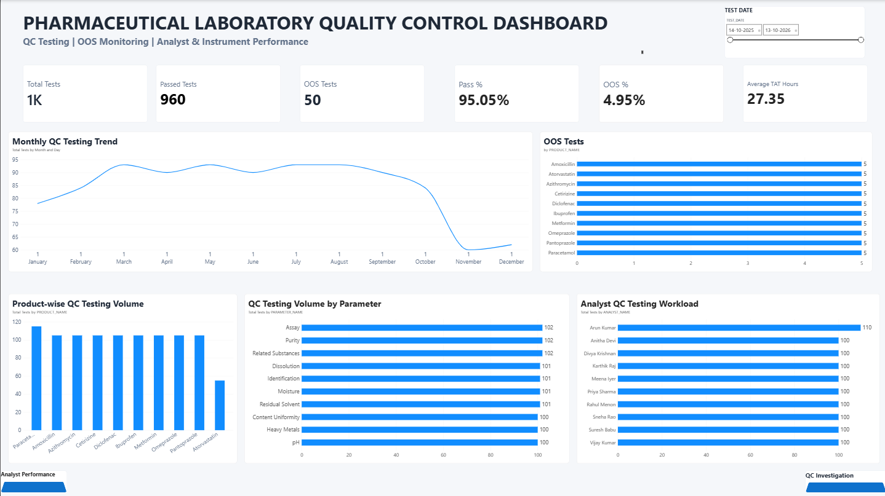
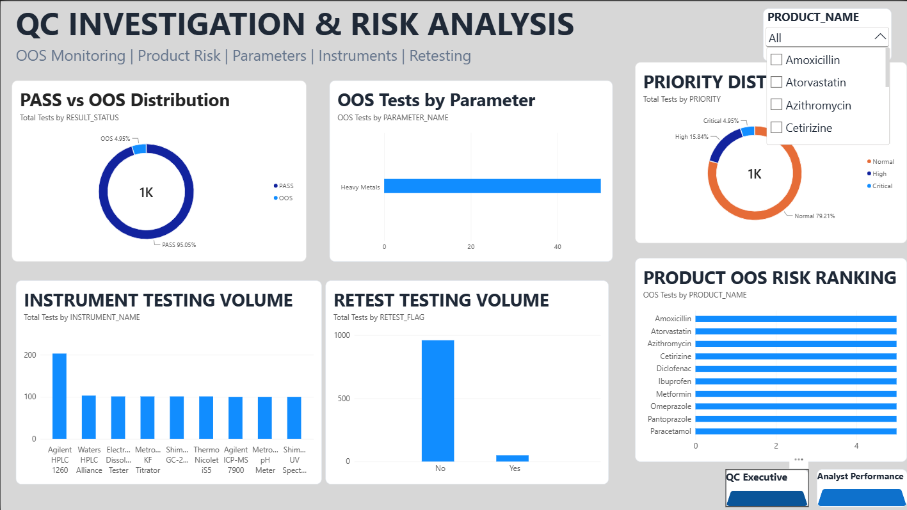
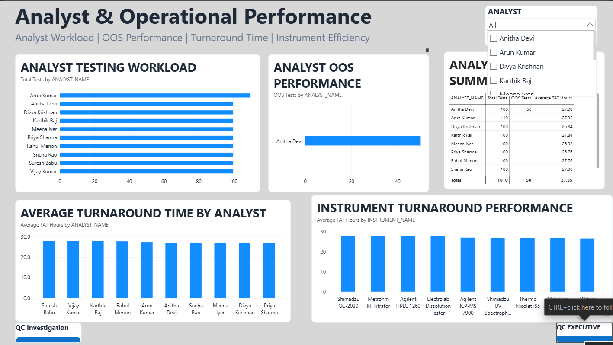

# Pharmaceutical Laboratory Quality Control & Testing Analytics

## 📌 Project Overview

An end-to-end Pharmaceutical Laboratory Quality Control analytics project developed using **Oracle SQL, SQL*Plus, PL/SQL and Microsoft Power BI**.

The project simulates a laboratory QC environment where testing results, pharmaceutical products, specifications, analysts and laboratory instruments are managed and analyzed to identify:

- Quality control performance
- Out-of-Specification (OOS) results
- Product and parameter risks
- Analyst workload and performance
- Instrument utilization
- Retesting activity
- Turnaround Time (TAT)

The final analytical dataset is connected to an interactive **Power BI dashboard** for business and QC decision-making.

---

## 🎯 Business Objective

The objective of this project is to transform laboratory testing data into actionable quality-control insights.

The solution helps QC teams:

- Monitor laboratory testing volume
- Identify PASS and OOS results
- Analyze OOS patterns by product and parameter
- Evaluate analyst workload
- Monitor instrument performance
- Analyze retesting activity
- Track laboratory turnaround time
- Identify potential product and operational risks

---

## 🏗️ Technology Stack

| Technology | Purpose |
|---|---|
| Oracle SQL | Data querying and analysis |
| SQL*Plus | Database interaction and script execution |
| PL/SQL | Data generation and business-rule processing |
| Oracle Views | Analytical data preparation |
| Window Functions | Ranking and advanced analysis |
| Power BI | Dashboard and visualization |
| DAX | KPI calculations |
| Power Query | Data transformation |
| CSV | Oracle 10g → Power BI data bridge |

---

## 📊 Project Scale

- **1,010** laboratory test records
- **10** pharmaceutical products
- **10** QC analysts
- **12** laboratory instruments
- **10** testing parameters

---
---

## 📊 Power BI Dashboard

This project includes a 3-page Power BI dashboard for pharmaceutical laboratory quality control analytics.

### 1. QC Executive Dashboard



### 2. QC Investigation & Risk Analysis



### 3. Analyst & Operational Performance


## 🗄️ Database Architecture

The project uses a relational laboratory QC data model.

### Core Tables

```text
PRODUCTS
    │
    ├── Product Master Data
    │
SPECIFICATIONS
    │
    ├── Testing Parameters & Specification Limits
    │
ANALYSTS
    │
    ├── QC Analyst Information
    │
INSTRUMENTS
    │
    ├── Laboratory Instrument Information
    │
LABORATORY_RESULTS
    │
    └── Central Laboratory Testing Data
